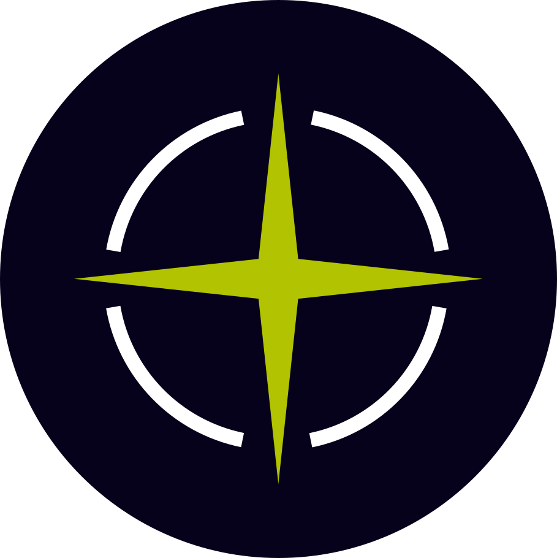
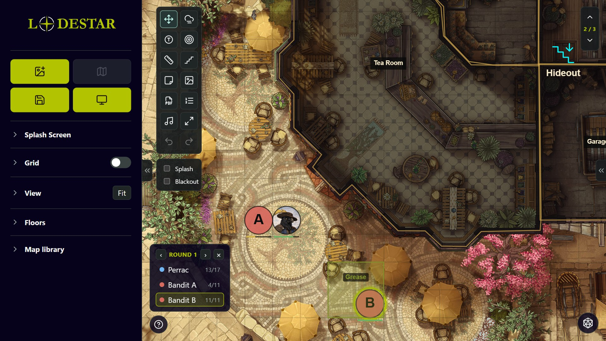
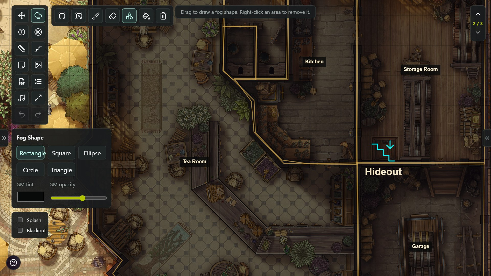
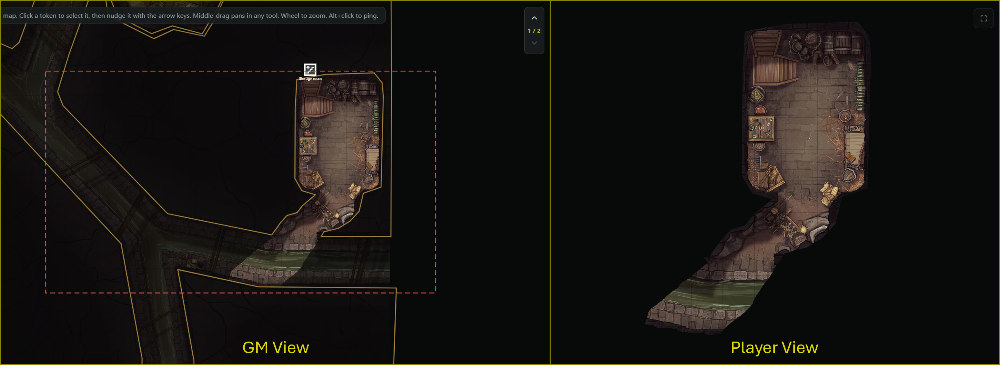
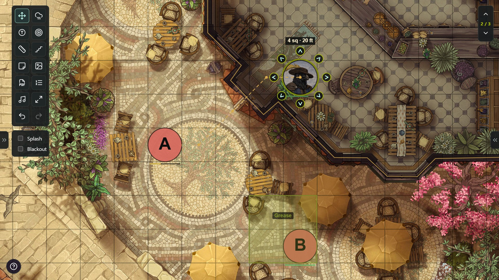
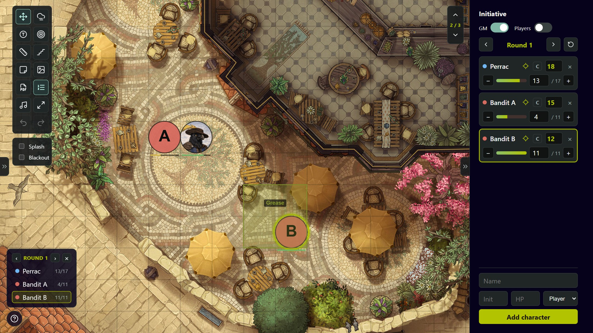
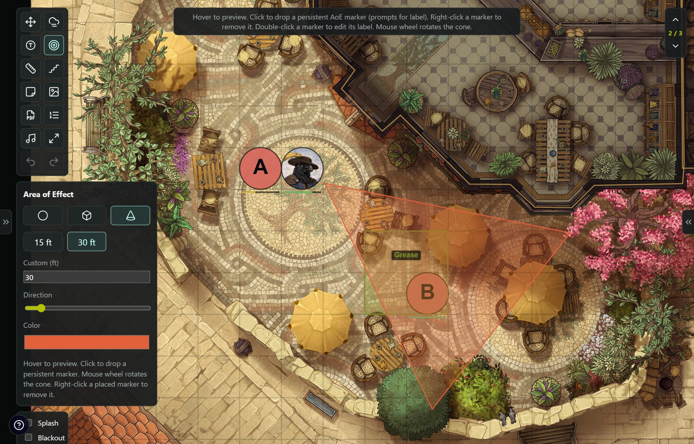
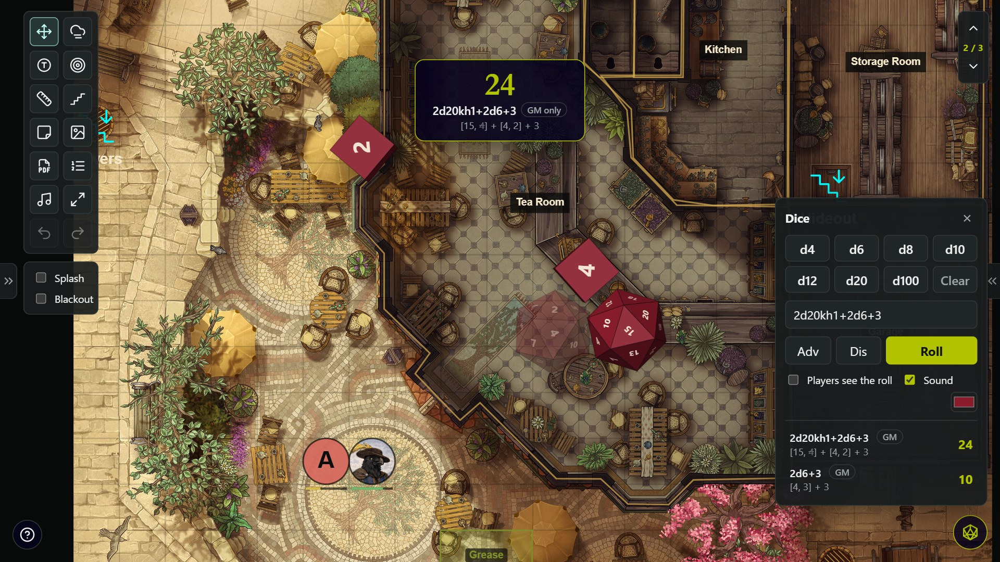

  

  <b>A battlemap display tool for game masters.</b> 
  Cast a map with fog of war to your players' screen while you run everything from a private GM panel. 
  Free, open source, and it runs entirely in your browser: no account, no install, no server.

  <a href="https://lodestarvtt.com"><b>▶ Try it live</b></a> ·
  <a href="https://lodestarvtt.com/manual.html"><b>📖 User manual</b></a> ·
  <a href="https://github.com/UnclePlants/Lodestar/releases/latest"><b>⬇ Download</b></a>

  
  
  

## Quick start

1. Open **[lodestarvtt.com](https://lodestarvtt.com)**, or click **Try the demo** for a ready-made three-floor map with fog, tokens, initiative and music.
2. **Load a map** with the first button in the GM panel: an image, an animated GIF, or a video.
3. Click **Open player display**, drag that window onto your TV or second screen, and press **F** for fullscreen.
4. Cover the map with **fog**, then reveal rooms as the party explores. Your players only ever see what you've revealed.
5. **Save map** keeps the whole setup in your browser's library, ready for next session.

Prefer to run it offline? [Download the latest release](https://github.com/UnclePlants/Lodestar/releases/latest), unzip it, and open `index.html`. It works the same.

## A quick tour

<table>
  <tr>
    <td width="50%"> <b>Fog of war</b>: trace, draw, paint or bucket-fill fog, and name areas so you can reveal a whole room at once.</td>
    <td width="50%"> <b>Player display</b>: the red frame on your screen is exactly what your players see. Drag it to move their view.</td>
  </tr>
  <tr>
    <td> <b>Tokens</b>: drag or step tokens on the grid, with the path and distance traced as they go.</td>
    <td> <b>Initiative</b>: turn order, HP, concentration, and a turn ring on the active combatant's token.</td>
  </tr>
  <tr>
    <td> <b>Areas of effect</b>: live spell templates on both screens, or pin them as persistent markers.</td>
    <td> <b>3D dice</b>: physically simulated dice, rolled in secret or thrown on the players' screen too.</td>
  </tr>
</table>

## Features

### Maps and the player display

- **Any map**: high-resolution images, animated GIF/WebP/PNG, or MP4/WebM video maps from your own disk. Animated maps loop on both screens under the fog, grid and tokens, and videos stay in step between them.
- **Player display**: a second window for your TV, projector or second monitor. It can follow your view, fit the whole map, or keep its own zoom, position and rotation. A red frame on the GM screen shows what the players see; drag it to pan their view without moving yours.
- **TV-table scale**: lay a TV flat, zoom until one grid square matches your minis, and lock it. Every map then keeps that physical square size.
- **Multiple floors**: each floor has its own map, fog and tokens, linked by GM-only stairs.
- **Rotate** the map in 90° steps, or rotate just the player display so it reads the right way up from across the table.
- **Splash screen and blackout** to show an image or a black screen between scenes.
- **Weather** on the player display: rain, storms with lightning, snow, drifting fog, or rising embers, with intensity and wind, saved with each map.
- **Smooth fades**: revealed fog fades away on the player display, and changing map or floor fades through black.

### Fog of war

- Trace polygon areas and give them GM-only names.
- Drag out rectangles, squares, ellipses, circles and triangles for quick rooms.
- Paint fog with a round or square brush, fill the whole map with the bucket, and erase freely.
- Right-click a traced area to reveal it, clearing any painted fog inside it too.
- You see the fog as an adjustable tint; players see solid black. Tokens and images under the fog stay hidden from them.

### Tokens and combat

- **Tokens** with labels, colours, sizes or your own images, snapping to the grid. Add a batch by picking several image files at once. Select a token to edit it, give it a GM-only note, or hide it from players entirely.
- **Movement**: step a selected token with its pop-out arrows or the arrow keys; the path and distance are traced (5e alternating diagonals).
- **Conditions** on tokens, for **D&D 5e** or **Pathfinder 2e** (switchable): coloured badges with values (Frightened 2, exhaustion 3), optional round timers that count down with the initiative, and GM-only conditions the players never see.
- **Initiative tracker**: turn order, rounds, HP bars, damage and healing, and a **C** toggle for concentration. Add monsters with a modifier (`+2`) and hit dice (`2d8+2`) and Lodestar rolls them; **Roll initiative** re-rolls every monster in one throw. Link a row to a token for a turn ring and a GM-only HP bar. A compact order overlay can sit on your screen, the players', or both.
- **Saved rolls** on tokens ("Scimitar 1d20+4"): one click rolls them, labelled with the creature's name.
- **Areas of effect**: circle, square and cone templates in any colour and size, live on both screens. Click to pin one as a marker (Grease, Wall of Fire…) with an optional label.
- **3D dice roller**: build a roll on the pad (click a die to add it, right-click to take one off, **Clear** to start again) or type it: `1d20+5`, `4d6dl1`, `2d20kh1`, `d%`. One click for advantage or disadvantage. The dice really tumble and settle; tick *Players see the roll* to throw the very same dice on the player display, or keep it a secret GM roll. Style your dice with a live preview: colour, number colour, size, finish (satin, matte, glossy, metal, glass), font, and a glow, trail or sparks, plus a gold burst on a natural 20.
- **Measure** in feet or metres, and **ping** any spot with Alt+click.

### At the table

- **Music and sound**: a music layer and an ambience layer that loop together, a one-shot SFX soundboard, and saved scenes that recall the whole mix. Sound plays on the player display.
- **Handouts**: drop an image on the map, then move, resize and rotate it. Each one is hidden from players until you show it.
- **GM notes**: rich-text sticky notes on the map, never shown to players.
- **PDF windows**: open character sheets, stat blocks or rules beside the map.
- **Grid**: size, offset, colour and opacity. Drag a square over one cell of the map's printed grid to calibrate the grid, token snapping and the ruler in one go.
- **Undo and redo**, a **map library** with export and import, **session autosave** you can resume, and a built-in shortcut sheet (press `?`).

The [user manual](https://lodestarvtt.com/manual.html) walks through every tool, with pictures.

## Saving and backups

Everything you save (the map, fog, tokens, floors, grid and view) is stored in your browser's own storage (IndexedDB) on your computer. Nothing is ever uploaded: the hosted site is just static files with no server behind it.

Your session is also **autosaved** every few seconds as you play. If the tab closes or the browser crashes mid-session, the welcome screen offers **Resume autosave** next time. Closing the tab with changes that aren't in your library asks first.

That storage belongs to one browser, on one device, at one address. Maps saved on lodestarvtt.com won't appear in a downloaded copy, in another browser, on another computer, or in a private window, and clearing your browser's site data erases them.

To keep your maps safe or move them to another computer, use **Export** in the GM panel. It saves your whole library to one JSON file that you can **Import** anywhere.

## Keyboard shortcuts (GM)

| Keys | Action |
| --- | --- |
| `V` `P` `N` `B` `E` `T` `A` `M` `S` | Move · polygon fog · named fog area · brush · eraser · tokens · area of effect · measure · stairs |
| `D` | Dice roller |
| `F` | Fit the map to the screen |
| `[` / `]` | Brush size |
| `Ctrl+Z` / `Ctrl+Shift+Z` | Undo / redo |
| Arrow keys · `+` / `-` | Pan · zoom (with no token selected) |
| Arrow keys | Nudge the selected token one cell |
| Middle-mouse drag | Pan the map with any tool |
| `Enter` / `Esc` / `Backspace` | Polygon: place it / cancel / remove the last point |
| `Delete` | Remove the selected token, image or AoE marker |
| `Alt+click` | Ping |
| Right-click | Delete a token, fog area, AoE marker or stair |
| Double-click an AoE marker | Edit its label |
| `?` | Shortcut cheatsheet |

## Browser support

Made for current Chromium browsers (Chrome, Edge). Lodestar needs `BroadcastChannel`, `IndexedDB`, `ResizeObserver` and Canvas 2D, which every modern browser has. Animated GIF/WebP/PNG maps use `ImageDecoder` (WebCodecs); browsers without it show the first frame. Video maps play whatever the browser supports, so MP4 (H.264) and WebM are the safe choices. The GM and player windows talk over both `BroadcastChannel` and `window.postMessage`, so casting works even from `file://`.

## For developers

Lodestar is plain HTML, CSS and JavaScript with **no build step and no dependencies**: open `index.html` and it runs.

| File | What's in it |
| --- | --- |
| `index.html` | The GM and player UI, and the welcome screen |
| `app.js` | Everything else: maps, fog, tokens, floors, sync between windows, the library |
| `dice.js` | The dice roller: notation parser, rigid-body physics, and the 3D renderer |
| `weather.js` | Rain, storms, snow, fog and embers, drawn on their own overlay |
| `styles.css` | All styling |
| `manual.html` | The user manual (images in `manual/`) |

Fog, tokens, pings, measurements and stairs are stored in **native image pixels**, so they stay glued to the map at any zoom. A view is a centred map point plus a zoom level, which is why **Match GM view** frames the same region on a player screen of a different size. Fog is rasterised into an offscreen layer capped at 4096 px on the long edge. Older save files are migrated automatically when they load. The app is structured so it can later be wrapped as a desktop app (Electron, Tauri or WebView2).

Issues and pull requests are welcome.

## Credits

See [CREDITS.md](CREDITS.md) for icon attributions, the demo's map and music, and thanks to the community members whose ideas shaped Lodestar. The demo map is **"Tearooms"** by [Fantasy Atlas](https://www.patreon.com/c/Fantasy_Atlas/home).

## License

Lodestar is released under the [MIT License](LICENSE). Bundled icons are under their own open-source licenses (see [CREDITS.md](CREDITS.md)).
